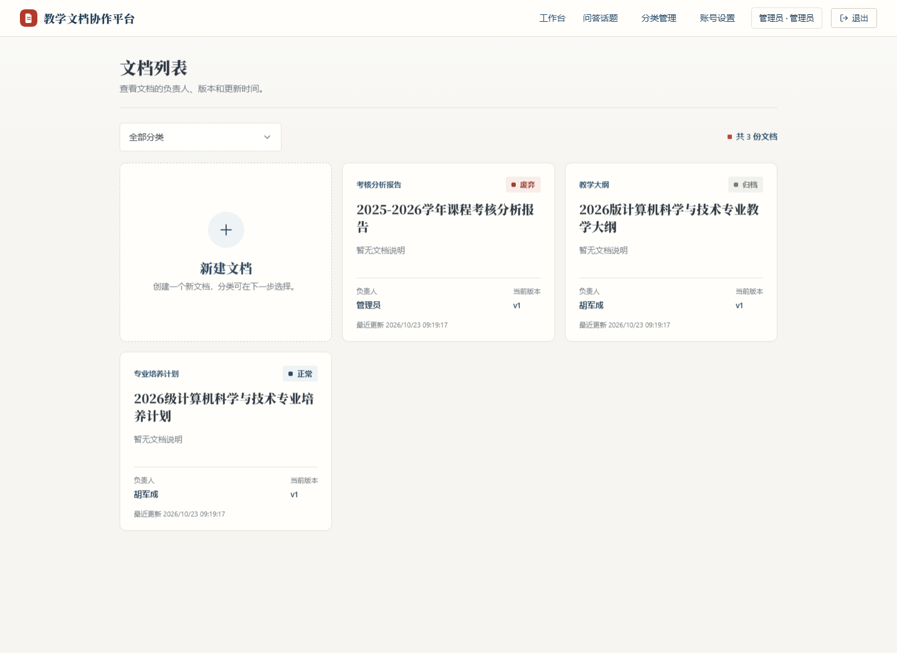
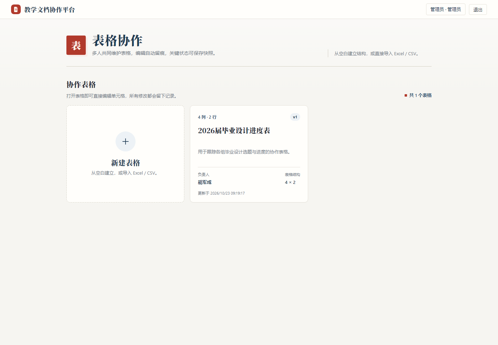
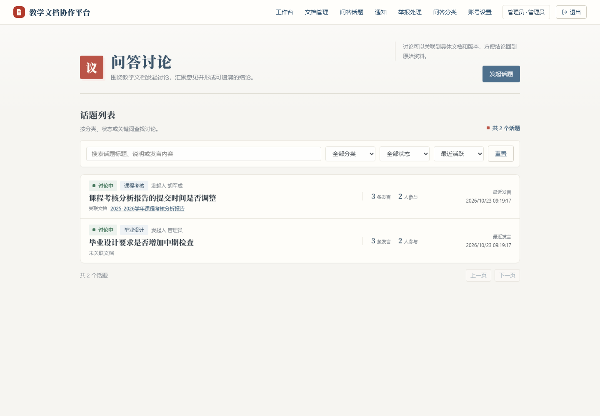

# 教学文档协作平台

面向教学团队的文档、表格与问答协作平台，覆盖从资料归档、多人编辑到讨论结论沉淀的完整流程。

当前仓库已实现三块业务模块，采用 Flask JSON API + 原生 HTML/CSS/JavaScript 前端：

| 模块 | 核心能力 | 主要使用角色 |
| --- | --- | --- |
| 文档管理 | 分类浏览、文档卡片、首个版本上传、版本历史、下载与权限控制 | 管理员维护，教师查看和协作 |
| 表格协作 | 空白创建、Excel / CSV 导入、行内编辑、公式重算、修改记录与版本回滚 | 登录用户协作，创建者和管理员管理 |
| 问答讨论 | 话题筛选、高密度讨论流、关联文档与版本、时间线发言、意见汇总和最终结论 | 登录用户参与，管理员处理治理事项 |

当前后端测试结果：**221 passed**。

## 界面预览

| 文档管理 | 表格协作 | 问答讨论 |
| --- | --- | --- |
|  |  |  |

## 目录

- `docs/`：全部文档的索引和分组见 `docs/README.md`（需求、架构、接口规范、原型验收、微信登录手册与流程、部署、工作日志）。上游给的原始 PDF 收在 `docs/reference/` 下，只做参考，不属于本仓库产出。
- `prototype/`：业务方向原型的入口页，下面存放 `documents/`（文档管理模块原型）、`qa/`（问答管理模块原型）、`table/`（表格协作模块原型）和 `taskman/`（任务看板原型，已从入口页撤下、文件暂留），均已接入 Flask API。
- `backend/`：Flask 后端实现。

后端单独运行时，优先查看 `backend/README.md`。

文档管理模块的业务走查见 `docs/business-walkthrough.md`。

## 功能说明

### 文档管理

- 从分类进入文档列表，新建入口会继承当前分类。
- 文档以卡片展示分类、状态、负责人、当前版本和更新时间，支持桌面三列、平板两列、手机单列。
- 创建文档时填写基本信息并上传首个文件，系统自动生成 `v1`。
- 支持拖放上传、字段级校验、版本历史、版本下载和负责人权限控制。

### 表格协作

- 支持从空白逐列创建，或直接导入 `.xlsx`、`.xls`、`.csv`。
- 导入读取第一个工作表，限制为 2,000 行、30 列、5 MB。
- 支持四则运算、单元格/区域引用，以及 `SUM`、`AVERAGE`、`COUNT`、`MIN`、`MAX`、`IF`、`ROUND` 等常用函数。
- 修改输入单元格后自动重算相关公式；无法计算但文件中有原结果的公式会保留并锁定。
- 行内编辑、增删行列、修改记录、整表快照和版本回滚均已接入真实 API。

### 问答讨论

- 话题以高密度讨论流展示，方便按状态、分类和活跃时间快速比较。
- 支持关联具体文档和版本，查看发言时间线、发言统计与参与人数。
- 支持意见汇总、最终结论、话题分类、结束话题、通知与举报处理。
- 可通过关键词、分类、状态和排序方式筛选，并保留分页。

## Python 环境说明

仓库使用根目录下的 `.venv` 作为本项目的 Python 虚拟环境：

| 环境     | 用途     | 主要依赖                                                    | 对应代码     |
| ------ | ------ | ------------------------------------------------------- | -------- |
| `.venv` | 本项目后端 | Flask、Flask-SQLAlchemy、Flask-Migrate、Flask-Login、pytest | `backend/` |

该环境的 `include-system-site-packages` 是 `false`，不会继承 Anaconda base 里的包。

进入项目环境：

```powershell
& .\.venv\Scripts\Activate.ps1
```

两条规矩：

- 装包统一用 `python -m pip install ...`，不要用裸 `pip`。
- 提示符前缀是 `(.venv)` 时，当前终端才在使用本项目环境。

如果提示「在此系统上禁止运行脚本」，先执行一次：

```powershell
Set-ExecutionPolicy -Scope Process -ExecutionPolicy RemoteSigned
```

## 本地运行后端

```powershell
.\.venv\Scripts\python.exe -m pip install -r backend\requirements.txt
.\.venv\Scripts\python.exe -m flask --app backend\run.py db upgrade
.\.venv\Scripts\python.exe -m flask --app backend\run.py seed
.\.venv\Scripts\python.exe backend\run.py
```

默认账号：

- 管理员：`admin / admin123`
- 文档负责人：`teacher / teacher123`
- 普通教师：`viewer / viewer123`

## 微信登录

登录页支持微信扫码登录，默认是「演示模式」，不用申请微信应用也能演示：

- 演示模式（默认）：后端没配 `WECHAT_APP_ID`，点「模拟微信扫码登录」直接登录；设 `$env:WECHAT_MOCK_ENABLED = "0"` 可以关掉。
- 真实模式：配好 `WECHAT_APP_ID` / `WECHAT_APP_SECRET` / `WECHAT_REDIRECT_URI` 后自动切换，走微信开放平台扫码或公众号网页授权。
- 绑定已有工号：登录后进右上角「账号设置」→「绑定微信」，绑定后扫码登录的就是同一个账号，权限和负责的文档都不变。

当前交付状态：**演示模式可用、真机联调暂停**（试过公众平台测试号 + 公网隧道，排错记录见 `docs/worklog-2026-09-27.md`）。配置项、命令手册、排错对照表和恢复联调的清单都在 `docs/wechat-login-guide.md`；原理和时序见 `docs/wechat-auth-flow.md`；一键起隧道用 `.\tools\wechat-tunnel.ps1`。

## 查看原型

`http://127.0.0.1:5000/` 是原型入口页，展示三个已完成的业务模块：

| 原型       | 入口                                           | 说明                            |
| -------- | -------------------------------------------- | ----------------------------- |
| 文档管理模块原型 | `http://127.0.0.1:5000/documents/index.html` | 分类与文档卡片 / 新建并生成 v1 / 版本与下载 |
| 问答管理模块原型 | `http://127.0.0.1:5000/qa/index.html`        | 讨论流 / 时间线 / 意见汇总 / 结论与治理 |
| 表格协作模块原型 | `http://127.0.0.1:5000/table/index.html`     | 空白或文件导入 / 行内编辑 / 公式 / 版本回滚 |

先启动后端：

```powershell
.\.venv\Scripts\python.exe backend\run.py
```

再打开 `http://127.0.0.1:5000/`，未登录会先进入登录页，登录成功后回到模块入口页，再选择进入文档管理、问答讨论或表格协作。原型页面不能直接双击打开，因为 `file://` 方式无法调用 Flask API。

## 常见问题

### 运行 pytest / flask 报 ModuleNotFoundError: No module named 'flask_login'

说明当前终端用的不是本项目的虚拟环境。看提示符就能分辨：`(base)` 是 Anaconda 自带的 Python，`(.venv)` 才是本项目的环境。

本项目的依赖（Flask、Flask-Login、pytest 等）只装在 `.venv` 里，所以有两种正确写法：

```powershell
# 写法一（推荐）：直接用虚拟环境里的 python，不用管有没有激活
.\.venv\Scripts\python.exe -m pytest backend\tests -q
.\.venv\Scripts\python.exe -m flask --app backend\run.py db upgrade

# 写法二：先激活虚拟环境，再直接敲命令
.\.venv\Scripts\Activate.ps1
pytest backend\tests -q
```

想确认当前用的是哪个 python：

```powershell
python -c "import sys; print(sys.executable)"
```

输出路径里带 `\.venv\` 才是本项目的环境。

### 打开页面显示 404 Not Found

说明 5000 端口上跑的很可能不是本项目的后端。先看是谁占着端口：

```powershell
netstat -ano | findstr :5000
```

判断方法：本项目后端的 `/api/health` 返回 `{"status":"ok"}`，并且 `/` 就是原型入口页。如果返回的是别的格式（例如 `{"code":0,"data":...}`），或者 `/` 是 404，那说明端口被另一个程序占用了。停掉它以后重新运行 `backend\run.py`：

```powershell
Stop-Process -Id <占用端口的 PID>
```

### 不想关掉占用 5000 的程序

换端口启动：

```powershell
.\.venv\Scripts\python.exe -m flask --app backend\run.py run --port 5001
```

然后访问 `http://127.0.0.1:5001/`。

### 以前的页面地址打不开了

原型页面已经整理到 `prototype/documents/` 下，地址要加一层目录，例如：

```text
旧：http://127.0.0.1:5000/categories.html
新：http://127.0.0.1:5000/documents/categories.html
```

## 测试

```powershell
.\.venv\Scripts\python.exe -m pytest backend\tests
```

当前完整测试集：

```text
221 passed
```

## 数据库迁移

```powershell
.\.venv\Scripts\python.exe -m flask --app backend\run.py db init --directory backend\db_migrations
.\.venv\Scripts\python.exe -m flask --app backend\run.py db migrate -m "initial"
.\.venv\Scripts\python.exe -m flask --app backend\run.py db upgrade
```
